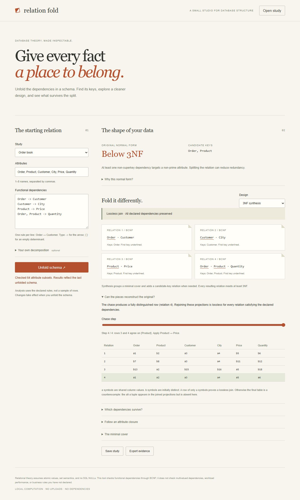

# Relation Fold

A local database-design studio for functional dependencies, candidate keys, and inspectable normalization. Compare a dependency-preserving 3NF synthesis with a lossless BCNF decomposition, or check your own proposed relations.



## Run

Requires Python 3.10+ to serve the page and a modern browser. Node 22+ is needed only for development checks. There are no installed runtime dependencies or external services.

```sh
python run.py --port 8000
```

Open http://127.0.0.1:8000. The server binds to loopback and exposes only five static app assets. Analysis runs in a Web Worker; no schema data is sent to a server. Save a study before closing the tab: there is no automatic persistence.

## A useful workflow

1. Enter comma-separated attribute names and one functional dependency per line, such as `Order, Product -> Quantity`.
2. Unfold the schema to find every candidate key and classify the original relation through BCNF. Inspect concrete violating dependencies.
3. Compare 3NF synthesis and BCNF decomposition. Each fragment shows all its candidate keys; the first is underlined.
4. Inspect the chase tableau step by step. A fully distinguished row proves lossless reconstruction. For a lossy split, the final tableau supplies a counterexample whose projected join contains a spurious all-distinguished tuple.
5. Check each declared dependency against the union of the full projections onto the fragments. Explore an attribute closure and its derivation.
6. Save the last analyzed study or export the full analysis, including all violations, projected dependencies, split steps, and chase snapshots.

The bundled order-book study decomposes six attributes into four BCNF relations while preserving all declared dependencies. The BCNF-tradeoff study is already in 3NF; its BCNF split loses `Student, Course -> Instructor`. The lossy-split study preserves both declared rules but fails reconstruction. These are deliberately separate properties.

[Example study](docs/example.json) can be opened from the app. Editing inputs does not update the results until **Unfold schema** is pressed. Save/export use the last successful analysis, not unsubmitted edits.

## Algorithms and guarantees

- Attribute sets use integer bitmasks. Exhaustive subset enumeration is feasible under the eight-attribute bound. Closure iterates applicable dependencies to a fixed point.
- Candidate keys are all minimal superkeys. The empty set can be a key when declared constant dependencies determine every attribute.
- A minimal singleton-right-side cover removes trivial rules, extraneous left attributes, and redundant rules. The result is equivalent and irredundant, but not necessarily unique.
- 3NF synthesis groups the cover by determinant, removes contained fragments, and adds a candidate-key relation if none contains one. It guarantees losslessness and dependency preservation.
- BCNF decomposition examines implied dependencies, splits a violating fragment into its determinant closure and the remainder plus determinant, and recurses. It guarantees losslessness; dependency preservation is checked separately.
- Projection uses the original dependency closure intersected with each fragment, including inference paths through attributes outside that fragment.
- Lossless-join checking uses the FD chase with union-find equality classes and distinguished symbols preferred during merging. Complete merge snapshots are exportable. The fixed-point tableau is a constructive counterexample when no distinguished row appears.

The implementation follows standard relational design theory; see [RPI's normalization notes](https://www.cs.rpi.edu/academics/courses/fall24/csci4380/fall2024/course_notes/normalization.html) for closure, normal forms, and chase background.

## Input and model boundaries

Up to eight distinct attributes, forty dependency lines, and twelve distinct custom fragments. Names are case-sensitive ASCII identifiers starting with a letter, at most 24 characters. Sets use commas; dependencies use `->`; `{}` or a blank left side means the empty determinant. Right sides must be nonempty. Every attribute must appear in a custom decomposition. Study JSON is limited to 50 KB and each text field to 12,000 characters.

The model assumes atomic values, relational set semantics, and no SQL NULLs. It does not infer business rules from sample records, check multivalued/join dependencies beyond FDs, recommend workload indexes, or generate a production migration. “Below 3NF” is not a claim about a specific lower normal form. All mathematical checks concern the rules actually supplied.

Evidence JSON includes the attribute-name order. A mask's bit `i` corresponds to `attributes[i]`. Chase symbols `0..n-1` are distinguished column values; larger numbers are nondistinguished equivalence classes. The interface previews at most twelve original violations; the export contains all of them.

## Verification

```sh
node --test
npm run check
python -m unittest discover -s tests -v
```

Twelve JavaScript tests and one HTTP-boundary test cover known examples, empty determinants, minimal covers, implied projections, constructive lossy counterexamples, and parser bounds. Randomized checks include 300 schemas compared against all legal two-row agreement patterns, 200 cover/synthesis/BCNF invariant checks, and 300 binary chase comparisons against the intersection-key theorem. CI runs Node 22/24 on Linux and Node 24 on Windows.

Browser checks exercised all three example studies, design switching, keyboard chase scrubbing, closure selection, invalid-input feedback, both downloads, and saved-study import. A separate Python relational-model oracle verified the downloaded order-book keys, dependency-preservation results, and fixed-point chase tableaux for all three designs.

## Layout

`core.js` contains the pure algorithms and validation; `worker.js` isolates analysis; `app.js` renders text safely through DOM APIs. `run.py` supplies a small loopback static server with a strict asset allowlist and content-security policy. The paper-fold interface uses responsive layouts, keyboard controls, and reduced-motion support.
